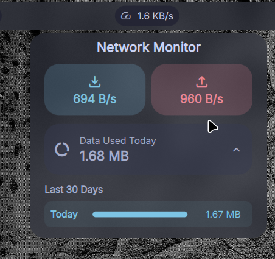
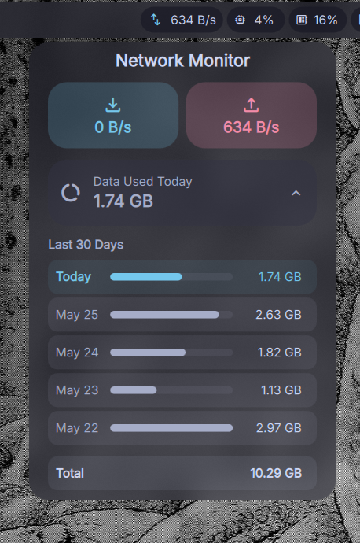

# 🌐 Network Indicator — DankBar Widget

A real time network speed and data usage monitor plugin for [DankMaterialShell](https://danklinux.com/docs/dankmaterialshell/overview). It internet speed directly in your DankBar, and automatically tracks your daily data usage!




## ✨ Features

- 📊 **Live speeds:** Monitor upload & download speeds right in your DankBar.
- 📅 **30-day data usage history:** Persistent tracking of your network data over the past month.
- 🔌 **Smart offline detection:** Differentiates between being disconnected locally versus connected to a router with no outbound internet access.
- ↕️ **Responsive design:** Works flawlessly in both horizontal and vertical DankBars.
- ⚙️ **Highly configurable:** Pin specific network interfaces, combine or separate speed readouts, and adjust units & polling rates.

## 📦 Installation

### Option 1: DMS Plugin Manager (recommended)

1. Open **DMS Settings** → **Plugins**
2. Click **Browse** and search for **Network Indicator**
3. Click **Install**, then restart: `dms restart`

### Option 2: DMS CLI

```bash
dms plugins install network-indicator
dms restart
```

### Option 3: Manual (git clone)

```bash
cd ~/.config/DankMaterialShell/plugins
git clone https://github.com/gemb0-0/Network-Indicator.git "Network Indicator"
dms restart
```

### After installing

1. Open **DMS Settings → Plugins** and click **Scan for Plugins**
2. Toggle **Network Indicator** on
3. Add it to your **DankBar** widget list
4. Restart: `dms restart`

## 🎛️ Settings

You can configure the plugin directly via the DMS Plugin Settings UI:

| Setting | Description | Default |
|---------|-------------|---------|
| **Update Interval** | How often to poll network statistics (1 to 10 seconds). | 2 sec |
| **Interface** | Select a specific network interface to track, or allow the plugin to automatically detect the active connection. | Auto-detect |
| **Display Unit** | Choose how speeds are displayed: Auto, KB/s, or MB/s. | Auto |
| **Display Mode** | **Separate** (show ↑ and ↓ individually) or **Combined** (single total speed). | Separate |
| **Check Internet Connectivity** | Periodically checks outbound reachability (via NetworkManager or curl probe). Can be toggled off for full privacy. | Enabled |

## 🛠️ How It Works

The plugin intelligently combines Linux's built-in system files with standard networking tools to provide an accurate representation of your network state:

| Component | Source / Tool | Purpose |
|------|--------|---------|
| **Byte Counters** | `/proc/net/dev` | Calculates pure upload/download speed deltas every polling cycle. |
| **Link State** | `/sys/class/net/*/operstate` | Detects physical/local network connections instantly. |
| **Network Name** | `iwgetid` / `iw` / `nmcli` | Fetches the SSID of the currently connected Wi-Fi network. |
| **Internet Check** | `nmcli` / Route Gate / `curl` | Verifies actual internet availability using a layered system: NetworkManager connectivity check, instant default route gate, and a hardened dual-endpoint curl probe (with captive portal detection). |
| **Persistence** | DMS Plugin State API | Saves daily usage per network across reboots within a 30-day rolling window. |

It automatically finds your active network interface by reading the kernel routing table (`/proc/net/route`), ignoring loopback and virtual interfaces (docker, veth, etc.), unless you explicitly pin an interface in the settings.

## 📄 License

MIT
